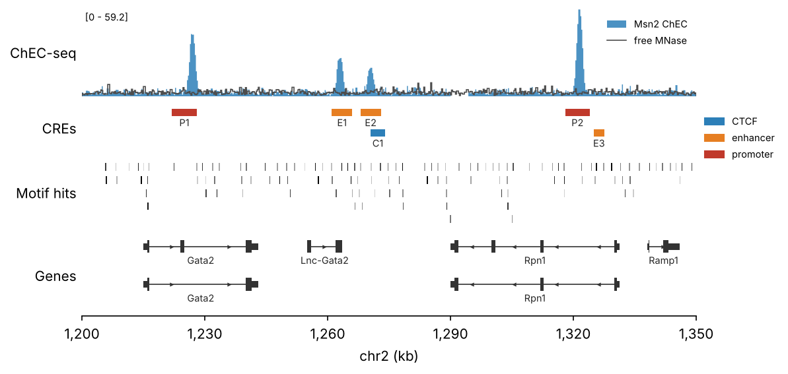

# pygenomic_tracks

Genome-browser-style tracks from pandas DataFrames, drawn on matplotlib axes.

**Documentation: <https://vmindel.github.io/pygenomic_tracks/>**

Every track is a function `fn(df, ax, region, **column_args)`. A DataFrame needs
`chrom`, `start`, `end` (0-based, half-open); arguments say which other column is used
and how. That is the shape pymisha returns from `gextract`, `gscreen` and
`gintervals_load`, so its output goes in without conversion.



```python
import pymisha as pm
import pygenomic_tracks as pygt

region = pygt.gene_region("mm10", "Gata2", flank=50_000)
scope = pm.gintervals(region.chrom, region.start, region.end)
chec = pm.gextract("chec.msn2", intervals=scope, iterator=50, colnames=["msn2"])

fig, axes = pygt.figure(region, heights=[1.2, 0.6, 0.9, 1.0])
pygt.signal(chec, axes[0], region, value="msn2", label="Msn2 ChEC")
pygt.intervals(cres, axes[1], region, color_by="cre", label_by="name", legend=True)
pygt.intervals(motif_hits, axes[2], region, color_by="score", palette="Greys")
pygt.genes("mm10", axes[3], region, transcripts="longest")
```

| track | draws |
|---|---|
| `pygt.signal` | numeric column as steps over real interval extents; gaps kept; aggregated to screen resolution (`max` by default); overlays share a scale |
| `pygt.intervals` | any BED-like table; one colour by default, opt-in `color_by` (categorical or numeric), `label_by`, `strand`; short features kept visible |
| `pygt.genes` | transcript models from a DataFrame, a GTF path or a UCSC genome name (`"hg38"`, downloaded and cached on first use) |

## Install

```bash
pip install git+https://github.com/vmindel/pygenomic_tracks
pip install "pygenomic-tracks[bigwig] @ git+https://github.com/vmindel/pygenomic_tracks"   # + pyBigWig
```

Dependencies: numpy, pandas, matplotlib.

## Commands

```bash
pygt download hg38 mm10 sacCer3   # fill the annotation cache (run on a login node)
pygt list                         # show cached annotations
pygt-install-skills               # install the Claude Code skill
```

## Claude Code skill

The package ships an Agent Skill that teaches Claude Code the API, its defaults and
the pymisha workflows. Install it with `pygt-install-skills`; see the
[docs](https://vmindel.github.io/pygenomic_tracks/claude-skill/).

## Development

```bash
pip install -e ".[test,docs]"
pytest                              # includes executing every tutorial
python docs/run_docs.py --update    # refresh tutorial output and figures
mkdocs serve
```
