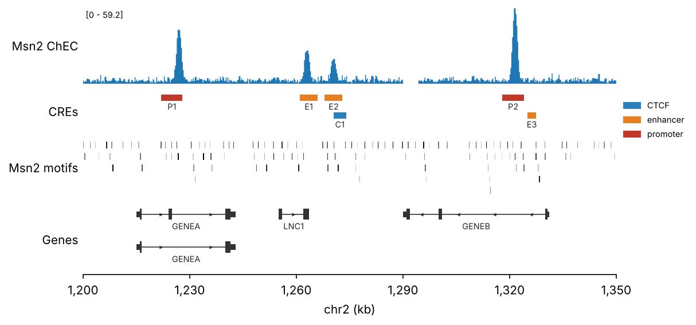

# pygenomic_tracks

Genome-browser-style tracks from pandas DataFrames, drawn on matplotlib axes.

Every track is a function `fn(df, ax, region, **column_args)`. A DataFrame needs
`chrom`, `start`, `end` (0-based, half-open); which other column is used, and
how, is set by arguments. That is the shape pymisha returns from `gextract`,
`gscreen` and `gintervals`, so its output goes in without conversion.



```python
import pymisha as pm
import pygenomic_tracks as pygt

region = "chr2:1,200,000-1,350,000"
scope = pm.gintervals("chr2", 1_200_000, 1_350_000)
chec = pm.gextract("chec.msn2", intervals=scope, iterator=50)

fig, axes = pygt.figure(region, heights=[1.2, 0.6, 0.9, 1.1])
pygt.signal(chec, axes[0], region, value="chec.msn2", label="Msn2 ChEC")
pygt.intervals(cres, axes[1], region, color_by="cre", label_by="name", legend=True)
pygt.intervals(motif_hits, axes[2], region, color_by="score", palette="Greys",
               strand="strand")
pygt.genes(pygt.read_gtf("gencode.gtf.gz"), axes[3], region, transcripts="longest")
```

Any track also works on a single `ax` of your own, without `pygt.figure`.

## Tracks

**`signal(df, ax, region, value="signal")`** draws intervals as steps over their
real extent, so variable-width bins are drawn correctly and gaps or NaN bins
stay empty. When there are more intervals than pixels it aggregates to about
one bin per pixel (`n_bins="auto"`, `agg="max"` so narrow peaks survive;
`"mean"` is overlap-weighted). `ylim=` takes a single ymax so several tracks can
share one scale.

**`intervals(df, ax, region)`** handles any BED-like table: peaks, CREs, motif
hits. It draws one colour by default; everything else is opt-in:

| argument | effect |
|---|---|
| `color_by="col"` | numeric column → colormap (`palette`, `vmin`, `vmax`); otherwise categories (`palette` = dict, list or colormap name) |
| `label_by="col"` | text under each feature; packing leaves room for it |
| `strand="col"` | arrowheads on features wide enough to hold them |
| `pack=False` | everything on one row instead of stacking overlaps |
| `min_width_px` | short features (12 bp motifs in a 150 kb window) are widened to stay visible; default 1 px |

**`genes(df, ax, region)`** takes a long table with one row per exon/CDS
(`read_gtf` returns one). It draws an intron line, exons, thicker CDS, strand
arrowheads and gene names. `transcripts="longest"` keeps one transcript per gene.

## Gene annotations

Pass a UCSC assembly name wherever an annotation is expected. It is downloaded
on first use, reduced to exon/CDS rows and cached:

```python
region = pygt.gene_region("mm10", "Myc", flank=50_000)   # Region from a gene name or id
pygt.genes("mm10", ax, region, transcripts="longest")
ann = pygt.annotation("hg38")                            # the DataFrame itself
```

Any UCSC assembly works (hg38, hg19, mm10, mm39, sacCer3, dm6, ce11, danRer11, ...).
The GTF comes from `goldenPath/<genome>/bigZips/genes/`, trying `ncbiRefSeq`,
`refGene`, `ensGene` and `knownGene` in that order; choose one explicitly with
`track="knownGene"` (GENCODE on hg38/mm39). UCSC chromosome names (`chr1`,
`chrI`) match misha databases built from UCSC sequences.

The cache lives in `$PYGT_CACHE_DIR`, else `~/.cache/pygenomic_tracks`. LSF
compute nodes often have no internet, so fill it from a login node:

```bash
pygt download hg38 mm10 sacCer3     # or: python -m pygenomic_tracks download ...
pygt list
```

Then call `pygt.annotation("hg38", download_missing=False)` in jobs, so a
missing genome fails at once rather than hanging on a download. Writes are
atomic, so parallel jobs sharing the cache don't corrupt it.

## Conventions

- Coordinates are 0-based, half-open. `read_gtf` shifts GTF starts by 1.
- Region strings `"chr2:1,200,000-1,350,000"` are read as 0-based, like BED.
- If a region's chromosome is missing from a table, the name with the `chr`
  prefix toggled is tried (`chr2` ↔ `2`), since misha databases differ.
- Columns can be renamed with `cols=("chr", "from", "to")`.

## Install

```bash
pip install -e .            # numpy, pandas, matplotlib
pip install -e '.[bigwig]'  # adds pyBigWig for pygt.from_bigwig
```
