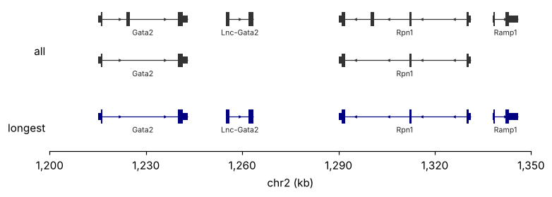
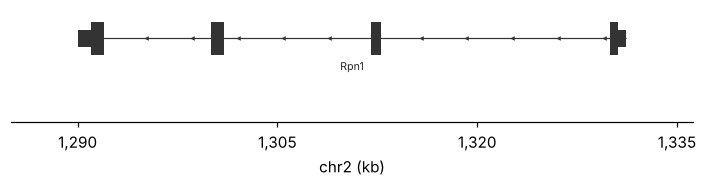

# Genes and annotations

[`pygt.genes`][pygenomic_tracks.genes] draws transcript models: an intron line with strand
arrowheads, exons, a thicker coding part, and the gene name. Its first argument can be a
DataFrame, a GTF path, or a genome name that is downloaded and cached on first use.

## The table

Gene models need **one row per exon and CDS**. A table with one row per gene has no exon
structure; draw that with [`pygt.intervals`](intervals.md) instead.
[`pygt.read_gtf`][pygenomic_tracks.read_gtf] reads a GTF into this shape and shifts
starts to 0-based:

```python
import pygenomic_tracks as pygt

region = pygt.example_region()
gtf = pygt.read_gtf(pygt.example_gtf_path())
print(gtf[["chrom", "feature", "start", "end", "strand", "transcript_id", "gene_name"]].head(6))
```

```text
  chrom feature    start      end strand transcript_id gene_name
0  chr2    exon  1215000  1216500      +     NM_0001.1     Gata2
1  chr2    exon  1224000  1225000      +     NM_0001.1     Gata2
2  chr2    exon  1240000  1243000      +     NM_0001.1     Gata2
3  chr2     CDS  1216000  1216500      +     NM_0001.1     Gata2
4  chr2     CDS  1224000  1225000      +     NM_0001.1     Gata2
5  chr2     CDS  1240000  1241500      +     NM_0001.1     Gata2
```

Columns used: `feature` (`exon`/`CDS`; other rows are ignored), `transcript_id` (groups
rows), `gene_name` (label) and `strand`. Each can be renamed with an argument.

## Isoforms

```python
fig, axes = pygt.figure(region, heights=[1.3, 0.7])
pygt.genes(gtf, axes[0], region, label="all")
pygt.genes(gtf, axes[1], region, transcripts="longest", color="navy", label="longest")
```



`transcripts="longest"` keeps one transcript per gene name. For RefSeq or GENCODE loci
with many isoforms it is usually what you want. Non-coding transcripts (Lnc-Gata2) have
no CDS rows and are drawn at full height. In coding transcripts the UTRs are drawn at
`utr_ratio` (0.5) of the CDS height.

## Finding a region by gene

[`pygt.gene_region`][pygenomic_tracks.gene_region] returns the span of all of a gene's
transcripts, plus flanks:

```python
reg = pygt.gene_region(pygt.example_gtf_path(), "Rpn1", flank=5_000)
print(reg)

fig, axes = pygt.figure(reg, heights=[0.8])
pygt.genes(pygt.example_gtf_path(), axes[0], reg, transcripts="longest")
```

```text
chr2:1,285,000-1,336,200
```



Names match exactly first, then case-insensitively, so `"RPN1"` also works. Gene ids
are accepted too.

## Genome names

For UCSC assemblies, skip the GTF handling entirely and pass the genome name:

```py
region = pygt.gene_region("mm10", "Myc", flank=50_000)

fig, axes = pygt.figure(region, heights=[1, 0.8])
pygt.signal(chec, axes[0], region)
pygt.genes("mm10", axes[1], region, transcripts="longest")
```

On first use for a genome this:

1. downloads `<genome>.<track>.gtf.gz` from
   `https://hgdownload.soe.ucsc.edu/goldenPath/<genome>/bigZips/genes/`;
2. keeps only exon and CDS rows, converts to 0-based and fills a missing `gene_name`
   from `gene_id`;
3. saves the raw GTF and the prepared table in the cache;
4. keeps the table in memory for the rest of the session.

Any UCSC assembly name works: `hg38`, `hg19`, `mm10`, `mm39`, `sacCer3`, `dm6`, `ce11`,
`danRer11` and others. UCSC gene tracks are tried in the order `ncbiRefSeq`, `refGene`,
`ensGene`, `knownGene`. Choose one explicitly with `track=`:

```py
pygt.genes("hg38", ax, region, track="knownGene")    # GENCODE
ann = pygt.annotation("hg38", track="knownGene")     # the DataFrame itself
```

UCSC chromosome names (`chr1`, yeast `chrI`) match misha databases built from UCSC
sequences.

!!! warning "Gene labels depend on the track"
    `ncbiRefSeq` and `refGene` label genes by symbol. With `ensGene`, `gene_name` may be
    an Ensembl or systematic id (yeast `YAL001C` rather than `TFC3`).

## The cache

| | |
|---|---|
| location | `$PYGT_CACHE_DIR`, else `$XDG_CACHE_HOME/pygenomic_tracks`, else `~/.cache/pygenomic_tracks` |
| contents | `<genome>/<genome>.<track>.gtf.gz` (raw) and `.pkl` (prepared) |
| inspect | `pygt list` or `pygt.cached()` |
| refresh | `pygt download hg38 --force` |

Writes go to a temporary file that is then renamed, so parallel jobs sharing a cache
never read a half-written file. If a pickle written by another pandas version fails to
load, it is rebuilt from the raw GTF.

## Clusters without internet

Compute nodes on LSF or SLURM clusters often cannot reach the internet. Fill the cache
once from a login node:

```bash
pygt download hg38 mm10 sacCer3
pygt list
```

In batch jobs, forbid downloads so a missing genome fails at once instead of hanging:

```py
ann = pygt.annotation("hg38", download_missing=False)
pygt.genes(ann, ax, region)
```

To share one cache across a lab, set `export PYGT_CACHE_DIR=/path/to/shared/cache` in
everyone's shell profile.

## Your own GTF

```py
gtf = pygt.read_gtf("gencode.vM25.annotation.gtf.gz")       # exon + CDS rows
gtf.to_parquet("gencode.vM25.exons.parquet")                 # read_gtf on GENCODE takes a while
pygt.genes(gtf, ax, region, transcripts="longest")
```

`pygt.genes(path, ...)` and `pygt.annotation(path)` also accept a GTF path and keep the
parsed table in memory for the session.
