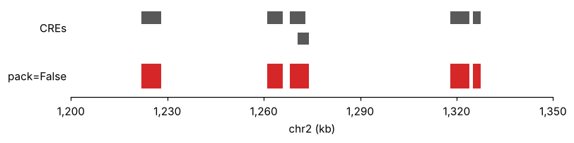
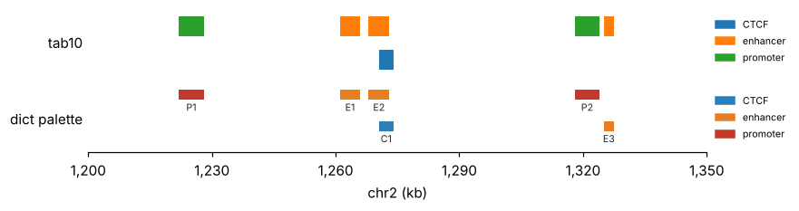
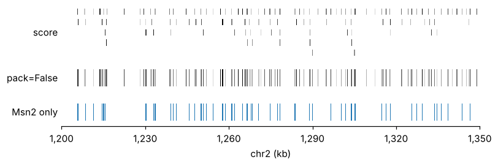
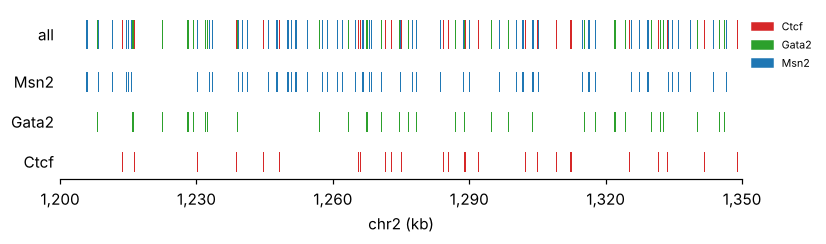
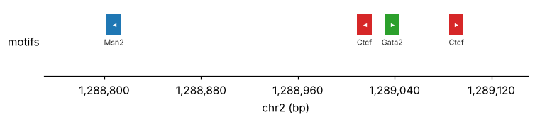

# Interval tracks

[`pygt.intervals`][pygenomic_tracks.intervals] draws any BED-like table as boxes: peaks,
regulatory elements, motif hits, `pymisha.gscreen` output, domains. It draws one colour
by default. Colour, labels and strand marks are switched on by naming the column to use.

```python
import pygenomic_tracks as pygt

region = pygt.example_region()
peaks = pygt.example_peaks()
hits = pygt.example_motif_hits()
print(hits.head(3))
```

```text
  chrom    start      end  motif  score strand
0  chr2  1205790  1205802   Msn2  12.42      +
1  chr2  1205966  1205978   Msn2  13.29      +
2  chr2  1208271  1208283  Gata2   8.67      +
```

## Default: one colour

```python
fig, axes = pygt.figure(region, heights=[0.5, 0.5])
pygt.intervals(peaks, axes[0], region, label="CREs")
pygt.intervals(peaks, axes[1], region, color="tab:red", pack=False, label="pack=False")
```



Overlapping features (E2 and C1) are stacked into rows. `pack=False` draws everything on
one row instead.

## Colour by category

A non-numeric `color_by` column is categorical. A dict `palette` fixes the colour of each
category, so the same class has the same colour in every figure you make:

```python
cre_colours = {"promoter": "#c0392b", "enhancer": "#e67e22", "CTCF": "#2c7fb8"}

fig, axes = pygt.figure(region, heights=[0.7, 0.7])
pygt.intervals(peaks, axes[0], region, color_by="cre", legend=True, label="tab10")
pygt.intervals(peaks, axes[1], region, color_by="cre", palette=cre_colours,
               label_by="name", legend=True, label="dict palette")
```



- Without a dict, categories are coloured from `tab10` (or `tab20` above ten categories)
  in sorted order **of the categories present in the window**. Another locus with
  different categories gets different colours, so use a dict for figure series.
- `label_by="name"` prints a label under each feature. Packing leaves room for the
  text, so labelled tracks need more rows.
- To use a numeric column as categories (cluster ids), cast it to string first:
  `df.assign(cluster=df.cluster.astype(str))`.

## Colour by a number: motif hits

A numeric `color_by` is mapped through a colormap. For motif hits this shows strong and
weak sites at a glance:

```python
fig, axes = pygt.figure(region, heights=[0.9, 0.5, 0.5])
pygt.intervals(hits, axes[0], region, color_by="score", palette="Greys", vmin=6,
               label="score")
pygt.intervals(hits, axes[1], region, color_by="score", palette="Greys", vmin=6,
               pack=False, label="pack=False")
pygt.intervals(hits.query("motif == 'Msn2'"), axes[2], region, color="tab:blue",
               pack=False, label="Msn2 only")
```



- 12 bp hits in a 150 kb window are narrower than a pixel. `min_width_px` (default 1)
  widens them around their centre so they remain visible. Use 2–3 for print.
- `vmin`/`vmax` default to the score range **in the window**. Fix them to compare
  loci.
- Dense hits stack into several rows. One row per motif (`pack=False`, one call per
  motif or a `query`) is usually easier to read.

## Several motifs

Colour by motif name, or give each motif its own row of axes:

```python
motif_colours = {"Msn2": "tab:blue", "Gata2": "tab:green", "Ctcf": "tab:red"}

fig, axes = pygt.figure(region, heights=[0.5, 0.35, 0.35, 0.35])
pygt.intervals(hits, axes[0], region, color_by="motif", palette=motif_colours,
               pack=False, legend=True, label="all")
for ax, motif in zip(axes[1:], motif_colours):
    pygt.intervals(hits[hits.motif == motif], ax, region, color=motif_colours[motif],
                   pack=False, label=motif)
```



## Strand

`strand="strand"` draws arrowheads on features at least 6 px wide. Motif hits only get
them when you zoom in:

```python
zoom = pygt.Region("chr2", 1_288_750, 1_289_150)
fig, axes = pygt.figure(zoom, heights=[0.6])
pygt.intervals(hits, axes[0], zoom, color_by="motif", palette=motif_colours,
               strand="strand", label_by="motif", label="motifs")
```



## From pymisha

```py
peaks = pm.gscreen("chec.msn2 > 20", intervals=scope)       # chrom, start, end
pygt.intervals(peaks, ax, region, color="tab:red")

cres = pm.gintervals_load("cres")                           # extra columns kept
pygt.intervals(cres, ax, region, color_by="type", label_by="name")
```
