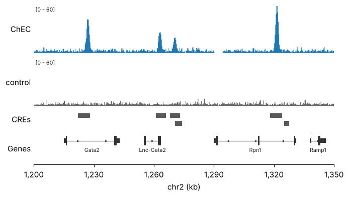
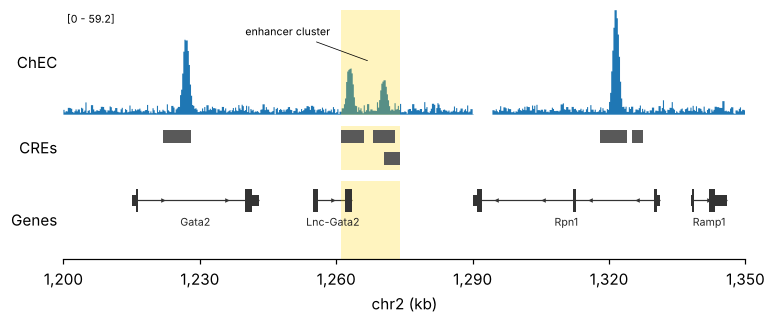
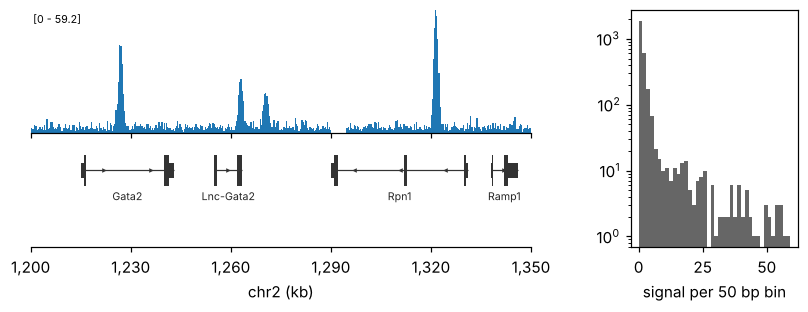
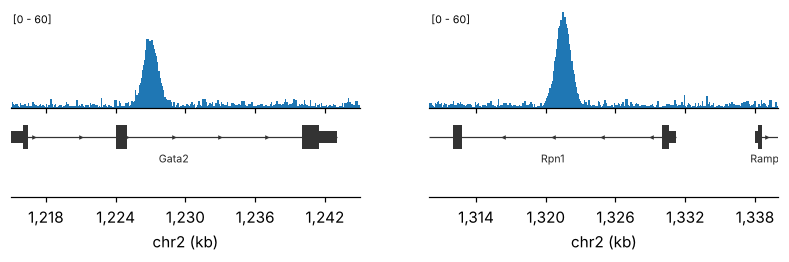

# Figure layout

pygt draws on ordinary matplotlib axes, so any layout matplotlib can make works.
[`pygt.figure`][pygenomic_tracks.figure] covers the common case of stacked tracks.

```python
import matplotlib.pyplot as plt
import pygenomic_tracks as pygt

region = pygt.example_region()
chec = pygt.example_signal("chec")
control = pygt.example_signal("control")
peaks = pygt.example_peaks()
gtf = pygt.example_gtf_path()
```

## Stacked tracks

```python
fig, axes = pygt.figure(region, heights=[1.5, 1.5, 0.5, 1], width=7, track_height=0.7)
pygt.signal(chec, axes[0], region, ylim=60, label="ChEC")
pygt.signal(control, axes[1], region, ylim=60, color="0.4", label="control")
pygt.intervals(peaks, axes[2], region, label="CREs")
pygt.genes(gtf, axes[3], region, transcripts="longest", label="Genes")
```



- `heights` sets the relative track heights, top to bottom.
- Figure height is `sum(heights) * track_height + 0.6` inches.
- All axes share x. Only the bottom one shows ticks, with units (bp, kb or Mb) chosen
  from the window length.

!!! note "Draw after sizing"
    Automatic binning, `min_width_px` and label packing measure the axes in pixels when
    the track is drawn. Create the figure at its final size first. If you resize it
    later, draw the tracks again.

## Highlights and marks

The axes use genomic coordinates, so matplotlib calls take bp positions directly:

```python
fig, axes = pygt.figure(region, heights=[1.2, 0.5, 0.9])
pygt.signal(chec, axes[0], region, label="ChEC")
pygt.intervals(peaks, axes[1], region, label="CREs")
pygt.genes(gtf, axes[2], region, transcripts="longest", label="Genes")
for ax in axes:
    ax.axvspan(1_261_000, 1_274_000, color="gold", alpha=0.25, lw=0)
axes[0].annotate("enhancer cluster", xy=(1_267_500, 30), xytext=(1_240_000, 45),
                 fontsize=7, arrowprops={"arrowstyle": "-", "lw": 0.5})
```



## Inside a larger figure

Tracks work on any axes, e.g. next to a scatter plot in a multi-panel figure. Shared
axes don't label themselves: call
[`pygt.format_genomic_axis`][pygenomic_tracks.format_genomic_axis] on the bottom track
and hide the tick labels of the ones above it:

```python
fig = plt.figure(figsize=(9, 2.8))
gs = fig.add_gridspec(2, 2, width_ratios=[3, 1], height_ratios=[1.2, 1], hspace=0.1,
                      wspace=0.3)
ax_sig = fig.add_subplot(gs[0, 0])
ax_gene = fig.add_subplot(gs[1, 0], sharex=ax_sig)
ax_side = fig.add_subplot(gs[:, 1])

pygt.signal(chec, ax_sig, region)
pygt.genes(gtf, ax_gene, region, transcripts="longest")
pygt.format_genomic_axis(ax_gene, region)
ax_sig.tick_params(labelbottom=False)
ax_side.hist(chec.signal.dropna(), bins=40, color="0.4")
ax_side.set(yscale="log", xlabel="signal per 50 bp bin")
```



## Several loci side by side

Give each locus its own column and share x only within a column. Use the same `ylim`
across loci, or heights cannot be compared:

```python
loci = [pygt.Region("chr2", 1_215_000, 1_245_000), pygt.Region("chr2", 1_310_000, 1_340_000)]

fig, axes = plt.subplots(2, 2, figsize=(9, 2.2), sharex="col",
                         gridspec_kw={"height_ratios": [1.2, 1], "hspace": 0.1})
for col, reg in enumerate(loci):
    pygt.signal(chec, axes[0, col], reg, ylim=60)
    pygt.genes(gtf, axes[1, col], reg, transcripts="longest")
    pygt.format_genomic_axis(axes[1, col], reg)
```



## Saving for papers

```py
import matplotlib
matplotlib.rcParams["pdf.fonttype"] = 42      # editable text in Illustrator
matplotlib.rcParams["svg.fonttype"] = "none"

fig.savefig("locus.pdf", bbox_inches="tight")
fig.savefig("locus.png", dpi=300, bbox_inches="tight")
```

Set the font types before drawing. Signal tracks are already reduced to about one step
per pixel, so PDFs stay small. Drawing with `n_bins=None` over a large window does not
reduce them, and the PDF gets very large.
