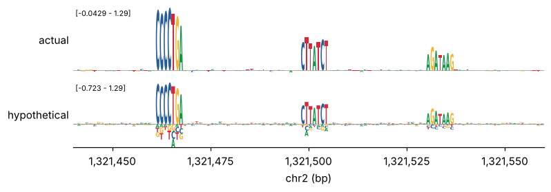
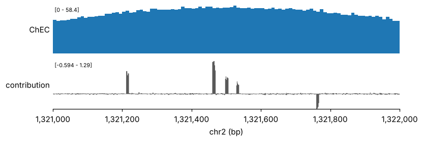
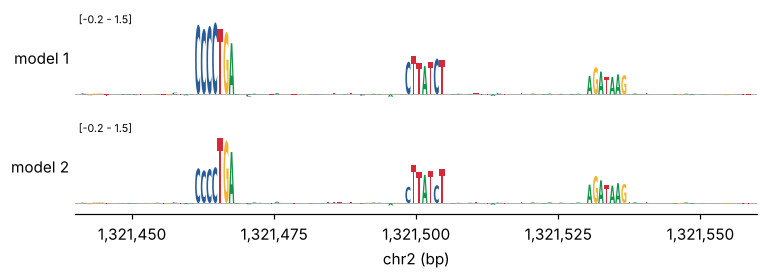
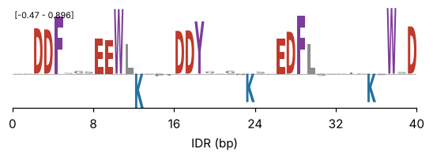

# Sequence logos

[`pygt.logo`][pygenomic_tracks.logo] draws letters scaled by a value per base and
position: contribution scores from DeepLIFT or integrated gradients, in silico
mutagenesis, or a PWM placed on the genome. Positive values stack upward from zero,
negative values downward, largest magnitude furthest out.

```python
import numpy as np
import pygenomic_tracks as pygt

hyp = pygt.example_attributions()
print(hyp.head(3))
```

```text
  chrom    start      end ref       A       C       G       T
0  chr2  1321000  1321001   A  0.0065 -0.0089 -0.0070  0.0104
1  chr2  1321001  1321002   A  0.0004 -0.0131  0.0316 -0.0021
2  chr2  1321002  1321003   T -0.0073 -0.0094  0.0114  0.0157
```

The table has one row per base pair and one column per letter. The column names are
the letters drawn, so `bases=` can name any alphabet.

## From a model's array

Attribution methods return an array, not a table. `pygt.logo_table` places it on the
genome. It accepts `(L, 4)`, channels-first `(4, L)`, or one score per position with a
`sequence`. With a 2-D array and a `sequence`, the scores are multiplied by the one-hot
encoding: hypothetical contributions become actual ones, a single letter per
position.

```python
scores = hyp[["A", "C", "G", "T"]].to_numpy().T   # (4, L), as a PyTorch model returns
seq = "".join(hyp.ref)
actual = pygt.logo_table(scores, "chr2", 1_321_000, sequence=seq)

zoom = pygt.Region("chr2", 1_321_440, 1_321_560)
fig, axes = pygt.figure(zoom, heights=[1, 1])
pygt.logo(actual, axes[0], zoom, label="actual")
pygt.logo(hyp, axes[1], zoom, label="hypothetical")
```



The actual track reads as the sequence the model used. The hypothetical track shows
what each other base would have contributed, which is where a weakened or reversed
site shows up. Pass `flip_below=True` to draw letters below zero upside down.

## Zoomed out

A letter needs a few pixels to be read. With the default `letters="auto"`, a window
in which one base spans fewer than `min_letter_px` pixels (2 by default) is drawn as
bars instead: the summed positive and summed negative values per position,
aggregated to screen resolution with `max` and `min`, so a single strong base is not
averaged away. In the same figure as the signal:

```python
window = pygt.Region("chr2", 1_321_000, 1_322_000)
chec = pygt.example_signal("chec", bin_size=10)

fig, axes = pygt.figure(window, heights=[1, 1])
pygt.signal(chec, axes[0], window, label="ChEC")
pygt.logo(actual, axes[1], window, label="contribution")
```



The negative bar near 1,321,760 is a site the model reads as repressive.
`letters=True` forces letters at any zoom and `letters=False` forces bars.

## Comparing logos

Each logo scales to its own range by default. To compare two models, or a wild-type
and a mutant sequence, pass the same `ylim`, as for signal tracks:

```python
fig, axes = pygt.figure(zoom, heights=[1, 1])
pygt.logo(actual, axes[0], zoom, ylim=(-0.2, 1.5), label="model 1")
pygt.logo(actual.assign(C=actual.C * 0.5), axes[1], zoom, ylim=(-0.2, 1.5), label="model 2")
```



## Colours and other alphabets

`colors=` overrides letters by name. Nucleotides default to green, blue, orange and
red; any other alphabet has no defaults, so letters not in `colors` are drawn in
`color`. Protein attributions work the same way with amino-acid columns, here a toy
IDR whose acidic and aromatic residues carry the signal:

```python
import pandas as pd

rng = np.random.default_rng(0)
idr = "SPDDFSGSEEWLKSPTDDYQSGNKSPEDFLSSGTPKSWSD"
aa = sorted(set(idr))
score = {"D": 0.6, "E": 0.5, "F": 0.8, "W": 0.9, "Y": 0.7, "L": 0.4, "K": -0.4}
per_res = np.array([score.get(r, 0.0) for r in idr]) + rng.normal(0, 0.03, len(idr))
prot = pygt.logo_table(per_res, "IDR", 0, sequence=idr, bases=aa)

acidic, aromatic, basic = "#C0392B", "#7D3C98", "#2471A3"
fig, axes = pygt.figure(("IDR", 0, len(idr)), heights=[1], width=6)
pygt.logo(prot, axes[0], ("IDR", 0, len(idr)), bases=aa, color="0.55",
          colors={"D": acidic, "E": acidic, "F": aromatic, "W": aromatic, "Y": aromatic,
                  "K": basic, "R": basic})
```



The x-axis is still labelled as a genomic window; for protein positions relabel it
with `axes[0].set_xlabel("residue")`.
