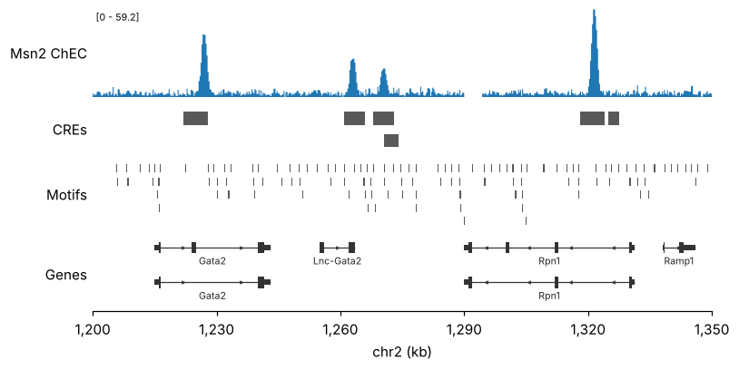
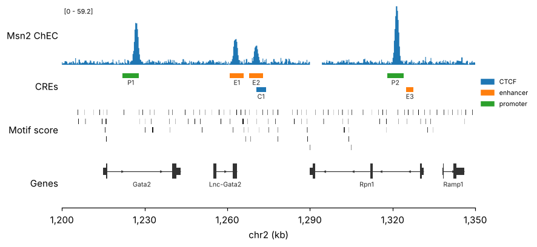

# Quick start

This page builds a four-track locus figure from the bundled example data: a signal
track, regulatory elements, motif hits and gene models.

## The one rule

Every track is a function with the same shape:

```py
pygt.<track>(df, ax, region, **column_args)
```

- `df` is a pandas DataFrame with `chrom`, `start`, `end` (0-based, half-open) plus
  whatever value columns the track needs.
- `ax` is a matplotlib axes.
- `region` is the window to draw.
- The keyword arguments say **which column is used for what**, e.g. `value="signal"`
  or `color_by="cre"`.

That is all the data model there is. pymisha's `gextract` and `gscreen` return exactly
this shape, as do BED files read with pandas.

## Example data

The package ships a small synthetic locus so that every tutorial runs offline:

```python
import pygenomic_tracks as pygt

region = pygt.example_region()
chec = pygt.example_signal("chec")
peaks = pygt.example_peaks()
hits = pygt.example_motif_hits()

print(region)
print(chec.head(3))
print(peaks)
```

```text
chr2:1,200,000-1,350,000
  chrom    start      end  signal  intervalID
0  chr2  1200000  1200050   0.989           1
1  chr2  1200050  1200100   1.610           1
2  chr2  1200100  1200150   0.458           1
  chrom    start      end name       cre  score
0  chr2  1222000  1228000   P1  promoter    880
1  chr2  1261000  1266000   E1  enhancer    410
2  chr2  1268000  1273000   E2  enhancer    350
3  chr2  1270500  1274000   C1      CTCF    600
4  chr2  1318000  1324000   P2  promoter    950
5  chr2  1325000  1327500   E3  enhancer    220
```

`chec` looks like `pymisha.gextract(..., iterator=50)` output: 50 bp bins with a value
column and pymisha's `intervalID`, which is ignored.

## A first figure

`pygt.figure` creates stacked axes that share one genomic x-axis. Each track is then
drawn on its own axes:

```python
fig, axes = pygt.figure(region, heights=[1.2, 0.6, 0.9, 1.0])

pygt.signal(chec, axes[0], region, value="signal", label="Msn2 ChEC")
pygt.intervals(peaks, axes[1], region, label="CREs")
pygt.intervals(hits, axes[2], region, label="Motifs")
pygt.genes(pygt.example_gtf_path(), axes[3], region, label="Genes")
```



- **Signal:** bins are drawn as steps over their real extent. The stretch of NaN bins
  near 1,290 kb is left empty rather than joined across. The `[0 - 59.2]` label gives
  the y-range, as in IGV.
- **Intervals:** one grey colour by default. Overlapping features are stacked into
  rows.
- **Genes:** `pygt.genes` accepts a GTF path, a DataFrame or a genome name such as
  `"hg38"` (see [Genes and annotations](genes.md)).

## Using more columns

The same tables, with more columns put to use:

```python
fig, axes = pygt.figure(region, heights=[1.2, 0.6, 0.9, 1.0])

pygt.signal(chec, axes[0], region, label="Msn2 ChEC")
pygt.intervals(peaks, axes[1], region, color_by="cre", label_by="name", legend=True,
               label="CREs")
pygt.intervals(hits, axes[2], region, color_by="score", palette="Greys", vmin=6,
               label="Motif score")
pygt.genes(pygt.example_gtf_path(), axes[3], region, transcripts="longest", label="Genes")
```



- `color_by="cre"` is categorical, so it gets a legend.
- `color_by="score"` is numeric, so it is mapped through a colormap.
- `transcripts="longest"` keeps one isoform per gene.

## Saving

Figures are plain matplotlib, so save them as usual:

```py
fig.savefig("locus.pdf", bbox_inches="tight")
```

Track labels sit to the left of the axes, so keep `bbox_inches="tight"`.

## Next

- [Signal tracks](signal.md): binning, shared scales, overlays, ratios.
- [Interval tracks](intervals.md): peaks, CREs and motif hits.
- [Genes and annotations](genes.md): GTFs, genome names, the download cache.
- [Figure layout](layout.md): custom layouts, highlights, several loci.
- [With pymisha](pymisha.md): from track expressions to figures.
