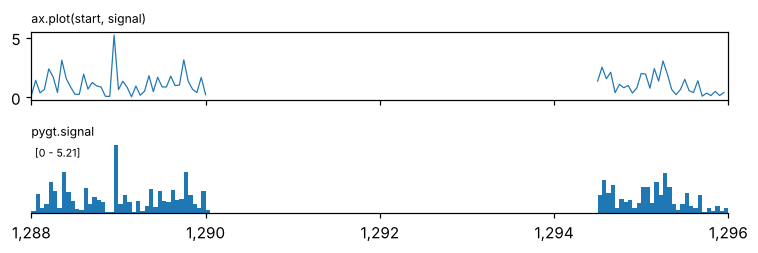
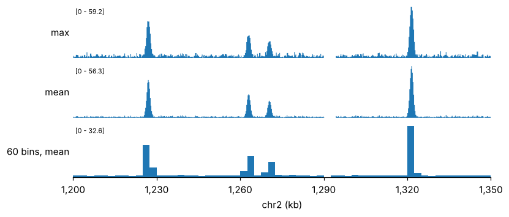
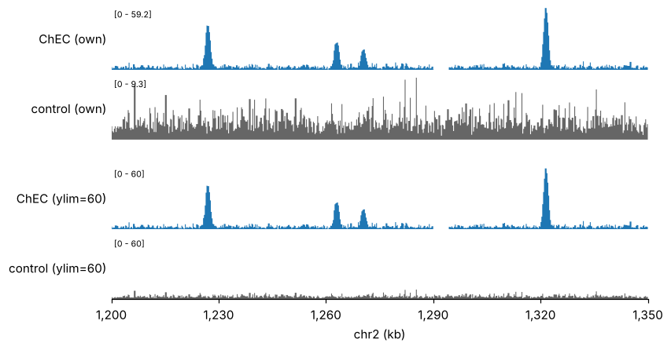
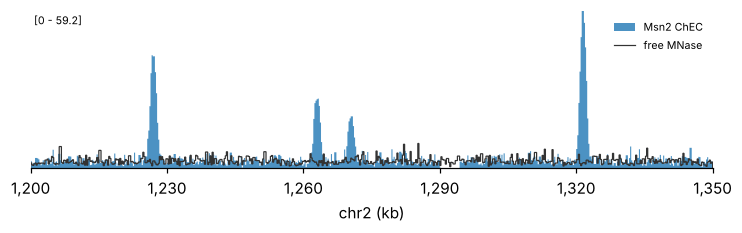
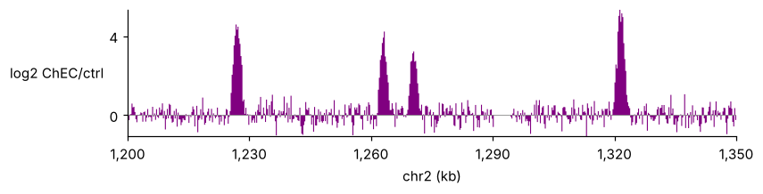

# Signal tracks

[`pygt.signal`][pygenomic_tracks.signal] draws a numeric column as a step function over
genomic intervals: coverage, ChEC-seq or ChIP-seq signal, ATAC, log-ratios, model
predictions.

```python
import matplotlib.pyplot as plt
import numpy as np
import pygenomic_tracks as pygt

region = pygt.example_region()
chec = pygt.example_signal("chec")
control = pygt.example_signal("control")
```

## Steps, not lines

A binned track is a set of intervals, not a set of points. Plotting bin starts with
`ax.plot` shifts every value by half a bin and draws straight lines across missing
data. `pygt.signal` draws each row over its own `[start, end)` and leaves gaps empty:

```python
zoom = pygt.Region("chr2", 1_288_000, 1_296_000)
sub = pygt.select(chec, zoom)

fig, (a, b) = plt.subplots(2, 1, figsize=(7, 2.4), sharex=True)
a.plot(sub.start, sub.signal, lw=0.8)
a.set_title("ax.plot(start, signal)", fontsize=8, loc="left")
pygt.signal(chec, b, zoom)
b.set_title("pygt.signal", fontsize=8, loc="left")
fig.tight_layout()
```



The NaN stretch (pymisha returns NaN where a sparse track has no data) is a visible gap
in the bottom panel. In the top panel matplotlib also breaks the line at NaN, but the
values sit at bin starts, so each step is shifted by half a bin. With irregular
intervals (peaks, bedGraph runs), straight lines between starts also misrepresent the
data.

## Binning and aggregation

A 150 kb window at 50 bp is 3,000 bins, more than the axes has pixels. By default
(`n_bins="auto"`) the rows are aggregated to about one bin per pixel before drawing.
`agg` sets how:

```python
fig, axes = pygt.figure(region, heights=[1, 1, 1])
pygt.signal(chec, axes[0], region, agg="max", label="max")
pygt.signal(chec, axes[1], region, agg="mean", label="mean")
pygt.signal(chec, axes[2], region, n_bins=60, agg="mean", label="60 bins, mean")
```



- `"max"` (default) keeps narrow peaks at full height. This is the right choice for
  ChEC or ChIP peaks in large windows.
- `"mean"` is weighted by overlap length. It is the right choice for coverage, where
  the average matters.
- `n_bins=<int>` fixes the resolution; `n_bins=None` draws every row unchanged.

Rows that **overlap** each other (for instance when the same bins were extracted
twice) cannot be drawn as one step function. With `n_bins="auto"` they are binned
automatically; with `n_bins=None` they raise an error.

## Comparing tracks: same scale

Each track scales to its own maximum by default. Two tracks next to each other then
look equally strong even when they are not:

```python
fig, axes = pygt.figure(region, heights=[1, 1, 0.2, 1, 1])
pygt.signal(chec, axes[0], region, label="ChEC (own)")
pygt.signal(control, axes[1], region, color="0.4", label="control (own)")
axes[2].set_visible(False)
pygt.signal(chec, axes[3], region, ylim=60, label="ChEC (ylim=60)")
pygt.signal(control, axes[4], region, color="0.4", ylim=60, label="control (ylim=60)")
```



Pass the same `ylim` (a single maximum, or `(min, max)`) to every track you want
compared.

## Overlays

Calling `pygt.signal` twice on the same axes overlays the series. The y-range covers
both, and `name=` adds a legend entry:

```python
fig, axes = pygt.figure(region, heights=[1.4])
pygt.signal(chec, axes[0], region, alpha=0.8, name="Msn2 ChEC")
pygt.signal(control, axes[0], region, color="0.2", fill=False, name="free MNase")
```



Draw the bigger signal first, or draw the second as an outline (`fill=False`), so that
neither hides the other.

## Negative values

Ratios and differences are signed. The y-range then spans zero, and the fill is drawn
from zero:

```python
ratio = chec.assign(signal=np.log2((chec.signal + 1) / (control.signal + 1)))
fig, axes = pygt.figure(region, heights=[1.2])
pygt.signal(ratio, axes[0], region, color="purple", agg="mean", range_label=False,
            label="log2 ChEC/ctrl")
axes[0].axhline(0, color="0.5", lw=0.5)
```



`range_label=False` keeps a conventional y-axis instead of the `[min - max]` label.
Here `agg="mean"` is used because the maximum of a ratio is dominated by noise.

## Other sources

Anything with `chrom, start, end` and a number works:

```py
cov = pygt.read_bed("sample.bedGraph", names=["chrom", "start", "end", "signal"])
bw = pygt.from_bigwig("sample.bw", region)            # requires pyBigWig
ext = pm.gextract("chec.msn2", intervals=scope, iterator=20, colnames=["msn2"])
pygt.signal(ext, ax, region, value="msn2")
```
